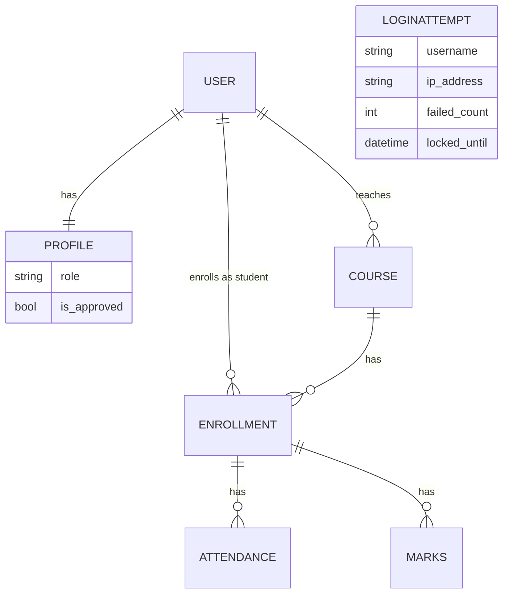

# CampusPro - Academic Management System

A role-based web app where an **Admin**, **Teachers** and **Students** manage courses,
attendance and marks. Built with Django. Core data lives in SQLite; audit logs and notices
live in MongoDB.

## Tech stack
Python, Django 4.2, SQLite, MongoDB (pymongo), HTML, CSS, JavaScript, Bootstrap 5, Chart.js

## Features by role

**Everyone**
- Approval-based registration (only *Student* or *Teacher* can be chosen; role validated on the server)
- Login with lockout (5 wrong passwords lock that username for 5 minutes)
- Forgot-password flow (reset e-mail is printed in the terminal in development)
- Notice board (MongoDB)

**Admin** (created only with `createsuperuser`)
- Approve / reject new users, view all users (search, filter, pagination), unlock locked accounts
- Course CRUD, assign teachers, enroll students
- Dashboard with stat cards and 4 charts
- Audit log page (search, filter, pagination, CSV export, chart)
- Export users and courses as CSV

**Teacher**
- Sees only own courses (403 for anyone else's course)
- Mark attendance, upload marks, search students, at-risk students (attendance below 75%)
- Export attendance of own courses as CSV

**Student**
- Dashboard with 3 charts and a low-attendance alert (below 75%)
- Attendance and marks per course, history with filter and pagination
- Printable report card (Print -> Save as PDF)

**E-mails** (console in development): registration received, approved / rejected, marks uploaded.

## Security features
- Role can never be "admin" from the registration form (checked in the form and on the server)
- New accounts stay pending until the admin approves; login is blocked meanwhile
- Role-based access control with a `role_required` decorator (403 page, no redirect loops)
- Students only ever see their own data (always `request.user`, never an id from the URL)
- CSRF token on every POST form; approve / delete / logout are POST-only
- Login lockout; the response never reveals whether a username exists
- CSV-injection protection (`=`, `+`, `-`, `@` are neutralised in every export)
- Chart data embedded with `json_script` (no XSS); no `|safe` on user data
- MongoDB filters are built only from validated values (no NoSQL injection)
- Production-only security settings (HTTPS redirect, secure cookies, HSTS) switch on when `DEBUG=False`

## Architecture: why two databases?
- **SQLite** holds the core, relational data (users, courses, enrollments, attendance, marks).
  It needs foreign keys, uniqueness rules and transactions.
- **MongoDB** holds audit logs and notices. They are write-heavy, flexible documents with no
  relations, and keeping them apart means a logging problem can never damage core data.
- If MongoDB is down the app keeps working: every Mongo call is wrapped in try/except.

## Folder structure
```
campuspro_project/
├── manage.py
├── requirements.txt
├── .env.example
├── campuspro/          settings.py, urls.py
├── academics/          models, views, forms, urls, admin, decorators,
│                       utils, audit, mongo, emails, tests
├── templates/          Bootstrap pages, partials/, error pages, password reset pages
└── static/js/charts.js shared Chart.js helpers
```

## Setup (Windows)
```bash
python -m venv venv
venv\Scripts\activate
pip install -r requirements.txt
copy .env.example .env        # then edit .env and set a strong SECRET_KEY
python manage.py migrate
python manage.py createsuperuser
python manage.py runserver
```
Open http://127.0.0.1:8000/ . MongoDB is optional: install MongoDB Community Server and keep it running
if you want the audit log and notices.

## Environment variables (`.env`)
| Variable | Meaning |
|---|---|
| SECRET_KEY | Django secret key (keep private) |
| DEBUG | `True` in development, `False` in production |
| MONGO_URI | e.g. `mongodb://localhost:27017` |
| MONGO_DB_NAME | e.g. `campuspro` |
| EMAIL_BACKEND | console backend in development, SMTP backend in production |
| EMAIL_HOST, EMAIL_PORT, EMAIL_USE_TLS, EMAIL_HOST_USER, EMAIL_HOST_PASSWORD, DEFAULT_FROM_EMAIL | SMTP settings (only for real e-mails) |

## Tests
```bash
python manage.py test
```
Covers registration + approval, role-based access, the student dashboard flow, lockout, exports and the report card.

## ER diagram


## Screenshots
_Add screenshots here before pushing to GitHub (login, admin dashboard, student dashboard, report card)._
